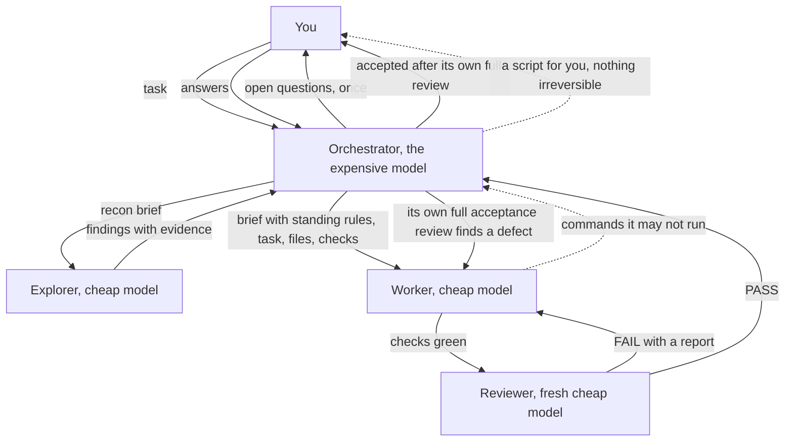

# delegation-rules

delegation-rules is an agent delegation system for Claude Code, Cursor and Codex that saves tokens with no compromise on quality: the expensive model sets up and verifies every task, while cheap delegates do the work in reviewed loops.

## How it works

- A task arrives. The orchestrator, which always carries the rule, first sends a small explorer to find the files involved and the open questions.
- It asks you those questions once, then cuts the work into short tasks.
- For each task it writes a brief: the standing rules of the role, pasted word for word, then exactly what to do and why, which files, which checks, and a time cap.
- A thin agent file turns each cheap model into a delegate. It pins the model and refuses any brief that lacks the standing rules.
- Explorers read and report with evidence, and say what they did not search.
- Workers edit only the files named and run the named checks until they are green.
- A fresh reviewer judges the result against the acceptance list and answers PASS, PASS-WITH-NOTES, FAIL or ESCALATE. On FAIL the same worker fixes it, and the reviewer looks again.
- The orchestrator reads the result itself before it accepts, and trusts no report.
- Delegates never ask anyone anything. They run only what the brief and the session notes allow, and hand back whatever they may not run.
- The orchestrator learns the sandbox and permission settings once per session, keeps them in those notes, and passes them on.
- Nothing irreversible happens without you: no commits, no deploys, no messages to real people.

## What is in `dist/`

- `rules/delegation.md` is the rule. `rules/delegation.mdc` is a link to it, which Cursor's glob needs.
- `agents/` is one flat folder of nine files:
  - Claude Code: `Explore.md`, `general-purpose.md`, `review.md`.
  - Cursor: `delegate-explore.md`, `delegate-worker.md`, `delegate-review.md`.
  - Codex: `delegate-explore.toml`, `delegate-worker.toml`, `delegate-review.toml`.
- `skills/enable-delegation/` is the skill that checks your setup.
- `AGENTS.md` is a link to the rule, for Codex.

## Getting started

1. Copy the contents of [`dist/`](dist/) into the settings folder of your tool: `~/.claude`, `~/.cursor` or `~/.codex`. The folder may differ, especially on Windows. Links instead of copies work too and follow updates.
2. Start a new session. `/enable-delegation` now appears; run it. It checks that every file is in place and matches the model table at the top of the rule, tells you what only you can do, and probes the delegates.
3. To change models or effort, edit the table at the top of the rule and the matching lines in the agent files, then run the skill again.
